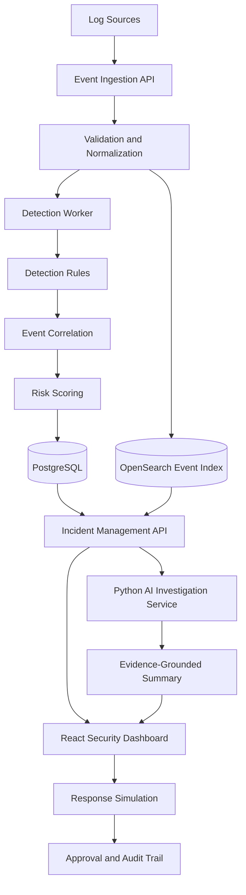

# SentinelX SIEM

### Detect. Investigate. Respond.

**SentinelX** is an AI-assisted Security Information and Event Management (SIEM) platform designed to collect, normalize, analyze, and correlate security events from multiple sources. It helps security teams identify suspicious activity, investigate potential threats, manage incidents, and evaluate response actions through a centralized dashboard.

The project combines rule-based threat detection, event correlation, risk scoring, incident management, and evidence-grounded AI assistance in a modular architecture.

> **Project status:** In Development  
> **Project type:** Enterprise Cybersecurity Platform  
> **Primary focus:** SIEM, Security Operations, Threat Detection, AI-Assisted Investigation  
> **Repository:** `sentinelx-siem`

---

## Table of Contents

- [Overview](#overview)
- [Why SentinelX?](#why-sentinelx)
- [Key Features](#key-features)
- [How It Works](#how-it-works)
- [Architecture](#architecture)
- [Technology Stack](#technology-stack)
- [Project Structure](#project-structure)
- [Getting Started](#getting-started)
- [Configuration](#configuration)
- [Example Security Scenarios](#example-security-scenarios)
- [API Overview](#api-overview)
- [Security Principles](#security-principles)
- [Development Roadmap](#development-roadmap)
- [Testing Strategy](#testing-strategy)
- [Project Documentation](#project-documentation)
- [Contributing](#contributing)
- [Disclaimer](#disclaimer)
- [License](#license)

---

## Overview

Modern organizations generate large volumes of logs from applications, servers, authentication systems, APIs, and infrastructure. Identifying security threats across these sources can be challenging when events are fragmented across different systems.

SentinelX aims to address this challenge by providing a centralized security monitoring and investigation platform.

The platform is designed to help users:

- Collect security events from multiple sources.
- Normalize logs into a consistent event schema.
- Detect suspicious activity using configurable detection rules.
- Correlate related events into meaningful security incidents.
- Assign risk scores to detected threats.
- Investigate incidents through a centralized dashboard.
- Use AI to summarize incidents and explain supporting evidence.
- Simulate security response actions with authorization and approval controls.
- Maintain an audit trail of important security operations.

SentinelX is designed as a modular, extensible project that can evolve from a local security monitoring lab into a more comprehensive security operations platform.

## Why SentinelX?

SentinelX explores how security monitoring, backend engineering, and AI-assisted investigation can work together in a single system.

| Challenge | SentinelX Approach |
|---|---|
| Logs come from different sources | Standardized event ingestion and normalization |
| Suspicious events are difficult to identify | Configurable, rule-based detection |
| Related events are investigated separately | Event correlation and incident grouping |
| Security alerts lack context | Risk scoring and contextual investigation |
| Large amounts of event data are difficult to review | AI-assisted incident summaries grounded in evidence |
| Response actions need oversight | Approval-based response simulation |
| Security operations need traceability | Auditable incident and response activity |

### Project Goals

1. Build a modular SIEM foundation with a clear separation of responsibilities.
2. Implement deterministic security detection before introducing advanced machine learning.
3. Integrate AI as an investigation assistant rather than an autonomous source of truth.
4. Apply security principles such as role-based access control, tenant isolation, and audit logging.
5. Provide a reproducible development environment for learning, testing, and demonstration.

---

## Key Features

### 1. Security Event Ingestion

Collect security events from supported sources and process them through a centralized ingestion pipeline.

Planned capabilities:

- REST API-based event ingestion.
- Sample log and event simulator.
- Event validation and normalization.
- Timestamp and source metadata handling.
- Duplicate event handling.
- Basic ingestion monitoring.

### 2. Event Normalization

Transform different log formats into a consistent internal event structure.

Standardized fields may include:

- Event ID
- Timestamp
- Tenant ID
- Source system
- Event category
- Source and destination IP addresses
- Username or actor
- Action and outcome
- Severity
- Raw event payload
- Normalized attributes

The normalized event schema allows detection rules to operate consistently across different log sources.

### 3. Rule-Based Threat Detection

Detect suspicious patterns through configurable detection rules.

Initial detection scenarios may include:

- Repeated failed authentication attempts.
- Successful authentication following repeated failures.
- Activity from unusual or unexpected IP addresses.
- Repeated access-denied events.
- Suspicious privilege changes.
- Unusual request patterns against simulated applications.

Detection rules should be transparent, testable, and configurable. Initial detection will rely on deterministic rules rather than unvalidated machine-learning predictions.

### 4. Event Correlation

Connect related security events to provide additional investigation context.

Correlation may use:

- Time windows.
- User identity.
- Source IP address.
- Host or application identifiers.
- Event categories.
- Related detection rule IDs.

For example, repeated failed logins followed by a successful login from the same source may be grouped into a single investigation context.

### 5. Risk Scoring

Assign a risk score to alerts or incidents using configurable factors, such as:

- Detection severity.
- Number of related events.
- Frequency of suspicious activity.
- Repeated behavior across a defined time window.
- Contextual indicators available to the detection engine.

Risk scores are intended to help prioritize investigations. They do not independently prove that an attack has occurred.

### 6. Incident Management

Manage security incidents through a centralized workflow.

Planned capabilities:

- Incident creation from detection results.
- Incident severity and status.
- Assignment to an analyst.
- Investigation notes.
- Related event references.
- Incident timelines.
- Resolution notes.
- Audit history.

### 7. AI-Assisted Investigation

Integrate a Python-based AI service to help analysts understand security incidents.

Potential capabilities:

- Generate incident summaries.
- Explain why a detection rule was triggered.
- Identify relevant events for further review.
- Produce investigation checklists.
- Suggest defensive investigation steps.
- Reference supporting event IDs in generated explanations.

**Evidence-first design:** AI-generated conclusions must be grounded in the event data provided to the model. Unsupported claims should be identified as uncertain, and AI output must not replace deterministic detection results.

### 8. Controlled Response Simulation

Provide a safe environment for demonstrating security response workflows.

Examples:

- Simulate blocking a source IP.
- Simulate disabling a test account.
- Simulate isolating a test host.
- Record approval and execution results.
- Track the operator and reason for each action.

The initial implementation is designed for **simulation only**. It must not execute destructive actions against production systems.

### 9. Audit Logging

Record important platform activities for accountability and investigation.

Examples include:

- Authentication and authorization events.
- Incident status changes.
- Detection rule modifications.
- AI investigation requests.
- Response simulation approvals.
- Administrative configuration changes.

Audit records should capture the actor, action, timestamp, target resource, and relevant outcome.

---

## How It Works

The following diagram illustrates the intended high-level workflow.



### Workflow Explanation

1. **Ingestion:** Events are submitted through an ingestion API or generated by the simulator.
2. **Normalization:** Incoming data is validated and converted into a standard event format.
3. **Indexing:** Searchable event data is stored in OpenSearch.
4. **Detection:** The detection worker evaluates events against configured rules.
5. **Correlation:** Related detections and events are grouped for investigation.
6. **Risk scoring:** The system calculates a prioritization score based on configured criteria.
7. **Incident management:** Alerts and their supporting evidence are made available to the incident workflow.
8. **AI investigation:** The AI service generates contextual summaries from approved evidence.
9. **Response simulation:** Authorized users can test response workflows without executing real production changes.
10. **Auditing:** Important operations are recorded for accountability.

---

## Architecture

SentinelX follows a modular architecture that separates the user interface, core business logic, AI capabilities, event search, and detection processing.

| Component | Responsibility |
|---|---|
| Web Dashboard | Security overview, alerts, incidents, investigation, and administration |
| Core API | Authentication integration, business logic, incident management, and API access |
| AI Service | Evidence-grounded summaries and investigation assistance |
| Detection Worker | Rule evaluation, event correlation, and risk scoring |
| PostgreSQL | Users, roles, incidents, detection metadata, and audit records |
| OpenSearch | Searchable security events and event analytics |
| Redis | Optional caching, temporary state, or queue-related support |
| Event Simulator | Generate controlled security events for development and testing |

### Architectural Principles

- Separation of concerns.
- Clear API contracts.
- Explicit event schemas.
- Stateless API services where practical.
- Independent detection processing.
- Evidence-grounded AI outputs.
- Least-privilege access.
- Reproducible local development.
- Observable and testable components.

The architecture is an intended design. Components should be introduced incrementally as their requirements become necessary.

---

## Technology Stack

| Layer | Technology | Purpose |
|---|---|---|
| Frontend | React | Security dashboard and user interface |
| Language | TypeScript | Type safety and maintainable frontend code |
| Styling | Tailwind CSS | UI styling and layout |
| Backend API | Go | Core API and security platform logic |
| AI Service | Python, FastAPI | AI-assisted investigation endpoints |
| Primary Database | PostgreSQL | Transactional and relational data |
| Event Search | OpenSearch | Event indexing and security log search |
| Optional Cache | Redis | Caching and supporting background workflows |
| Containerization | Docker, Docker Compose | Local services and development environment |
| API Testing | Postman or automated HTTP tests | API verification |
| Version Control | Git and GitHub | Source control and collaboration |

### Why This Stack?

- **React and TypeScript** support a maintainable, interactive security dashboard.
- **Go** provides a suitable foundation for API services and event-processing workloads.
- **Python and FastAPI** make it practical to integrate AI models and related libraries.
- **PostgreSQL** supports structured data, relationships, and transactional workflows.
- **OpenSearch** provides search capabilities for large volumes of indexed events.
- **Docker Compose** helps developers run and test the required services locally.

The technology choices may evolve as the project requirements and implementation mature.

---

## Project Structure

The planned repository structure is:

```text
sentinelx-siem/
├── apps/
│   └── web/                    # React + TypeScript dashboard
├── services/
│   ├── api/                    # Go core API
│   └── ai-service/             # Python + FastAPI service
├── workers/
│   └── detection/              # Rule evaluation and correlation
├── packages/
│   └── event-schema/           # Shared event contracts and schemas
├── database/
│   ├── migrations/             # Database schema migrations
│   └── seeds/                  # Development seed data
├── rules/
│   ├── authentication/         # Authentication detection rules
│   ├── network/                # Network-related rules
│   └── application/            # Application security rules
├── simulator/
│   └── events/                 # Safe sample event generators
├── deploy/
│   └── docker/                 # Container and deployment configuration
├── tests/
│   ├── integration/
│   ├── security/
│   └── fixtures/
├── docs/
│   ├── BRD.md
│   ├── PRD.md
│   ├── ARCHITECTURE.md
│   ├── API.md
│   └── THREAT_MODEL.md
├── .env.example
├── .gitignore
├── LICENSE
└── README.md
```

This structure is a starting point. Directories and services should be added when the corresponding implementation exists.

---

## Getting Started

### Prerequisites

Before running SentinelX, prepare the following tools:

- Git
- Docker
- Docker Compose
- Go
- Python
- Node.js and npm
- An editor such as Visual Studio Code

Use versions compatible with the project's dependency files and configuration.

### 1. Clone the Repository

```bash
git clone https://github.com/YOUR_USERNAME/sentinelx-siem.git
cd sentinelx-siem
```

Replace `YOUR_USERNAME` with your GitHub username or organization.

### 2. Configure Environment Variables

Create a local environment file from the example:

```bash
cp .env.example .env
```

On Windows Command Prompt:

```cmd
copy .env.example .env
```

Update the local configuration with the appropriate database settings, service URLs, and AI provider configuration.

Never commit real credentials, API keys, or production secrets.

### 3. Start the Services

Once the Docker Compose configuration and service implementations are available, the intended startup command is:

```bash
docker compose up --build
```

This command requires a valid Compose configuration. Until that configuration exists, follow the setup instructions for the individual implemented services.

### 4. Verify the Services

After implementing the relevant endpoints, verify that the API and AI service respond correctly.

Example health-check requests:

```bash
curl http://localhost:8080/health
curl http://localhost:8000/health
```

These paths and ports are proposed development defaults. They must match the actual application configuration.

### 5. Open the Dashboard

Once the frontend has been implemented and started, open the local URL configured by the web application, typically:

```text
http://localhost:5173
```

**Note:** The commands above describe the intended development workflow. They are not a guarantee that every service is currently implemented or operational.

---

## Configuration

The following environment variables are examples of planned configuration options.

| Variable | Purpose |
|---|---|
| `APP_ENV` | Application environment |
| `API_PORT` | Core API listening port |
| `DATABASE_URL` | PostgreSQL connection string |
| `OPENSEARCH_URL` | OpenSearch endpoint |
| `REDIS_URL` | Optional Redis connection string |
| `AI_PROVIDER` | Configured AI provider |
| `AI_MODEL` | Selected AI model |
| `AI_API_KEY` | Secret key for the configured AI provider |
| `LOG_LEVEL` | Application logging level |

The actual variable names may differ between services. Keep `.env.example` synchronized with the implemented configuration.

### Configuration Guidelines

- Use environment variables for secrets and environment-specific settings.
- Validate required configuration during application startup.
- Avoid logging passwords, tokens, or API keys.
- Use separate credentials for development and production.
- Restrict database and search-service access to authorized components.
- Do not expose internal services publicly without appropriate security controls.

---

## Example Security Scenarios

SentinelX can be developed and tested using simulated events in an isolated environment.

### Scenario 1: Repeated Authentication Failures

**Objective:** Identify repeated failed login attempts against a test account.

Example event:

```json
{
  "event_type": "authentication",
  "action": "login",
  "outcome": "failure",
  "username": "test-user",
  "source_ip": "192.0.2.10",
  "timestamp": "2026-10-16T09:00:00Z"
}
```

Expected behavior:

1. The event is validated and normalized.
2. The detection worker evaluates the event against the configured rule.
3. Repeated matching events may trigger an alert.
4. The alert is associated with supporting event records.
5. An incident can be created for investigation.

The IP address in this example belongs to a documentation range and is intended as sample data.

### Scenario 2: Failed Logins Followed by a Successful Login

**Objective:** Demonstrate event correlation across a time window.

Expected behavior:

- Detect repeated authentication failures.
- Identify a subsequent successful authentication when the correlation criteria match.
- Associate relevant events with the same investigation context.
- Calculate a configurable risk score.
- Provide an evidence-based incident summary.

This scenario is a detection exercise, not proof that a compromised account exists.

### Scenario 3: AI-Assisted Incident Investigation

**Objective:** Summarize a detected incident using its associated events.

Expected behavior:

- Supply only the relevant, authorized event data to the AI service.
- Request a structured incident summary.
- Include references to supporting event IDs.
- Distinguish observed facts from hypotheses.
- Validate the response before displaying it.
- Preserve the original detection result and event records.

### Scenario 4: Response Approval Simulation

**Objective:** Demonstrate a controlled response workflow.

Expected behavior:

1. An analyst requests a simulated response.
2. The platform validates the user's permissions.
3. The action is recorded with its intended target and reason.
4. An authorized user approves or rejects the request when required.
5. The simulation result and audit history are recorded.

No real account disabling, network blocking, or host isolation is performed by the initial simulator.

---

## API Overview

The following endpoints are a proposed API design. Implemented routes should be documented and versioned as the application develops.

| Method | Endpoint | Purpose |
|---|---|---|
| `GET` | `/health` | Service health check |
| `POST` | `/api/v1/events` | Ingest a security event |
| `GET` | `/api/v1/events` | Search or filter events |
| `GET` | `/api/v1/alerts` | Retrieve detection alerts |
| `GET` | `/api/v1/alerts/{id}` | Retrieve alert details |
| `GET` | `/api/v1/incidents` | List incidents |
| `POST` | `/api/v1/incidents` | Create an incident |
| `GET` | `/api/v1/incidents/{id}` | Retrieve incident details |
| `PATCH` | `/api/v1/incidents/{id}` | Update permitted incident fields |
| `POST` | `/api/v1/incidents/{id}/investigate` | Request AI-assisted investigation |
| `POST` | `/api/v1/responses/simulate` | Simulate a response action |
| `GET` | `/api/v1/audit-logs` | Retrieve authorized audit records |

### API Design Principles

- Use consistent request and response formats.
- Validate incoming payloads.
- Apply authentication and authorization to protected endpoints.
- Support pagination and filtering for large result sets.
- Return appropriate HTTP status codes.
- Avoid exposing sensitive internal details in error messages.
- Apply rate limits and request-size limits where appropriate.
- Validate tenant access before returning events or incidents.

---

## Security Principles

Security is a core requirement of SentinelX, not an optional enhancement.

### Authentication and Authorization

- Enforce authentication for protected operations.
- Apply role-based access control (RBAC).
- Follow the principle of least privilege.
- Require appropriate permissions for administrative changes and response approvals.
- Validate resource ownership and tenant boundaries on every relevant request.

### Tenant Isolation

If multi-tenancy is introduced, every tenant-scoped resource must be isolated and access-controlled.

Tenant identifiers must be derived from trusted authentication context wherever possible, rather than blindly accepted from user-submitted payloads.

### AI Safety

AI integrations introduce additional risks because security logs can contain attacker-controlled text.

SentinelX should:

- Treat log contents as untrusted data.
- Never execute instructions found inside logs.
- Avoid giving the AI service unrestricted access to tools or production systems.
- Require evidence references for material claims.
- Validate structured AI responses.
- Handle model timeouts, malformed output, and provider failures.
- Redact sensitive information before sending data to external AI providers when appropriate.
- Require human oversight for security response workflows.

### Data Protection

- Never commit secrets to source control.
- Use secure transport for deployed environments.
- Restrict access to logs and incident records.
- Define retention and deletion policies.
- Minimize sensitive information stored in logs.
- Protect backups and database credentials.
- Review dependencies and container images for known vulnerabilities.

### Auditability

Sensitive actions should generate auditable records containing the actor, action, target, timestamp, and result, without unnecessarily storing secrets or sensitive payloads.

---

## Development Roadmap

SentinelX is planned to evolve through incremental milestones.

- [ ] **Phase 1 — Foundation**
  - [ ] Initialize the repository structure.
  - [ ] Define event schemas and coding conventions.
  - [ ] Create the BRD, PRD, and architecture documentation.
  - [ ] Prepare local development configuration.

- [ ] **Phase 2 — Event Ingestion**
  - [ ] Implement the Go API foundation.
  - [ ] Validate and normalize incoming events.
  - [ ] Configure PostgreSQL and OpenSearch.
  - [ ] Create sample event fixtures.

- [ ] **Phase 3 — Detection Engine**
  - [ ] Implement configurable detection rules.
  - [ ] Add authentication failure detection.
  - [ ] Implement time-window correlation.
  - [ ] Add initial risk scoring.
  - [ ] Write unit and integration tests.

- [ ] **Phase 4 — Incident Management**
  - [ ] Implement incident CRUD operations.
  - [ ] Add incident status and assignment workflows.
  - [ ] Build the initial React dashboard.
  - [ ] Display events, alerts, and incident timelines.

- [ ] **Phase 5 — AI Investigation**
  - [ ] Build the FastAPI AI service.
  - [ ] Add evidence-grounded incident summaries.
  - [ ] Validate AI output and event references.
  - [ ] Handle timeouts and provider errors.
  - [ ] Test prompt-injection resistance.

- [ ] **Phase 6 — Response Simulation**
  - [ ] Implement response simulation endpoints.
  - [ ] Add permission and approval checks.
  - [ ] Record simulation outcomes.
  - [ ] Verify audit history.

- [ ] **Phase 7 — Hardening**
  - [ ] Add authorization and tenant-isolation tests.
  - [ ] Improve error handling and observability.
  - [ ] Review dependency and container security.
  - [ ] Document setup, limitations, and deployment.
  - [ ] Prepare a reproducible demonstration.

The roadmap represents planned work. Update the checklist as features are implemented and verified.

---

## Testing Strategy

Testing should cover functionality, reliability, and security.

### Unit Testing

- Event validation and normalization.
- Detection rule evaluation.
- Risk-score calculation.
- Correlation logic.
- Incident state transitions.
- AI response schema validation.

### Integration Testing

- API-to-database interactions.
- Event indexing and retrieval.
- Detection worker processing.
- Incident creation from alerts.
- AI service communication.
- Response simulation and audit logging.

### Security Testing

- Unauthorized API requests.
- Role-based permission enforcement.
- Cross-tenant access attempts.
- Malformed event payloads.
- Oversized requests.
- Sensitive information exposure.
- Prompt injection through simulated logs.
- AI timeout and malformed-output handling.
- Approval and audit-trail integrity.

### Reliability Testing

- Duplicate event ingestion.
- Temporary database unavailability.
- Search-indexing failures.
- Detection worker restarts.
- AI provider timeouts.
- Event reprocessing and recovery.

All security tests should be performed in an authorized development or test environment.

---

## Project Documentation

Additional documentation will describe the project in more detail.

| Document | Description |
|---|---|
| `docs/BRD.md` | Business requirements, stakeholders, objectives, and expected business value |
| `docs/PRD.md` | Functional requirements, user stories, acceptance criteria, and product scope |
| `docs/ARCHITECTURE.md` | System components, data flow, and technical decisions |
| `docs/API.md` | API endpoints, schemas, authentication, and error handling |
| `docs/THREAT_MODEL.md` | Threats, trust boundaries, risks, and mitigation strategies |

Create these files as the corresponding documentation is finalized, and keep them aligned with the actual implementation.

---

## Contributing

Contributions, suggestions, and constructive feedback are welcome.

### Suggested Workflow

1. Fork the repository.
2. Create a feature branch.
3. Implement a focused change.
4. Add or update relevant tests.
5. Update documentation when behavior or APIs change.
6. Submit a pull request describing the change and its verification.

Example:

```bash
git checkout -b feature/event-ingestion
```

Keep pull requests focused, avoid committing secrets, and include reproducible steps for testing changes.

Before contributing, review the project's license and contribution requirements.

---

## Disclaimer

SentinelX is an educational and development project intended to explore SIEM architecture, security event processing, threat detection, and AI-assisted investigation.

It is not a substitute for a professionally operated Security Operations Center (SOC), a mature commercial SIEM, or a complete enterprise security program.

Detection results can produce false positives and false negatives. AI-generated explanations may be incomplete or incorrect and must be verified against the underlying evidence.

Use only authorized data and systems. The initial response functionality is intended for simulation and testing, not autonomous production remediation.

---

## License

The project's license has not yet been selected.

Before publishing or distributing the project, add a `LICENSE` file and update this section to reflect the chosen license. Until then, do not assume the repository is licensed for unrestricted reuse or redistribution.

---

## Author

**Zurisky Aqsa Firmansyah**

Informatics Engineering Student | Full-Stack Development | AI Engineering

Interested in building scalable software systems, security platforms, backend services, and practical AI integrations.

---

**SentinelX — Detect. Investigate. Respond.**
